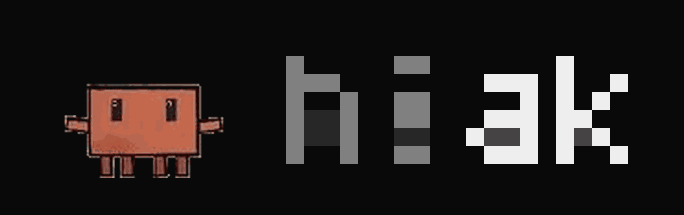

<div align="center">



<br />


<br /><br />

[](https://www.linkedin.com/in/harsha-sri-vardhan-lalam-9705a52a0)
[](mailto:harshasrivardhan.lalam@gmail.com)
[](https://github.com/Hiak-Harsha)

</div>

<br />


```text
> whoami
  hiak / harsha — developer & systems tinkerer

> focus
  building agentic AI workflows, quantitative pipelines,
  terminal-first developer tools, and full-stack software.
```

<br />


- [`Quant-Alpha-Engine`](https://github.com/Hiak-Harsha/Quant-Alpha-Engine) — multi-horizon market analysis, causal feature engineering & walk-forward backtesting
- [`dynamic-dual-model`](https://github.com/Hiak-Harsha/dynamic-dual-model) — dual-path LLM routing between deterministic muscle memory and deliberative reasoning
- [`custom-avatar-studio`](https://github.com/Hiak-Harsha/custom-avatar-studio) — OpenCode pixel typography engine & moving terminal/desktop mascot companion

<br />


<br />


<div align="center">


<br />

[](https://git.io/streak-stats)

</div>
