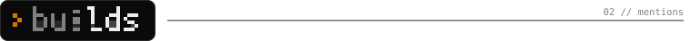

<div align="center">




<br />

[](https://www.linkedin.com/in/harsha-sri-vardhan-lalam-9705a52a0)
[](mailto:harshasrivardhan.lalam@gmail.com)
[](https://github.com/Hiak-Harsha)

</div>


```text
> whoami
  hiak / harsha — developer & systems tinkerer

> focus
  building agentic AI workflows, quantitative pipelines,
  terminal-first developer tools, and full-stack software.
```



- [`Quant-Alpha-Engine`](https://github.com/Hiak-Harsha/Quant-Alpha-Engine) — multi-horizon market analysis, causal feature engineering & walk-forward backtesting
- [`dynamic-dual-model`](https://github.com/Hiak-Harsha/dynamic-dual-model) — dual-path LLM routing between deterministic muscle memory and deliberative reasoning
- [`custom-avatar-studio`](https://github.com/Hiak-Harsha/custom-avatar-studio) — pixel typography engine & moving terminal/desktop mascot companion

<details>
<summary><code>+ more builds (click to expand)</code></summary>

<!-- REPOS_START -->
- [`Start---Up-Market-Research-Analysis`](https://github.com/Hiak-Harsha/Start---Up-Market-Research-Analysis) — startup funding & market research analysis
- [`gsoc-navigator-os`](https://github.com/Hiak-Harsha/gsoc-navigator-os) — GSoC Navigator OS - An Intelligent Open-Source & GSoC Preparation Platform
- [`Workspace-Navigator`](https://github.com/Hiak-Harsha/Workspace-Navigator) — multi-project workspace navigation utility
- [`Cli-Setup`](https://github.com/Hiak-Harsha/Cli-Setup) — automated CLI environment setup tool
- [`win-touchpad-fix`](https://github.com/Hiak-Harsha/win-touchpad-fix) — Universal Windows I2C HID Touchpad & Code 10 Fix for Lenovo, Dell, HP, Asus, and Acer laptops
- [`SessionVault`](https://github.com/Hiak-Harsha/SessionVault) — Full-laptop workspace & application preservation system with crash guard and zero-click startup recovery for Windows
- [`omnipolish`](https://github.com/Hiak-Harsha/omnipolish) — Python workflow & polish utilities
- [`gitam-portal-assistant`](https://github.com/Hiak-Harsha/gitam-portal-assistant) — Terminal CLI controller, popup-killer, and customizer for GITAM GStudent Portal
- [`Sahaaya`](https://github.com/Hiak-Harsha/Sahaaya) — Kotlin mobile application
- [`Movie-Recommendation`](https://github.com/Hiak-Harsha/Movie-Recommendation) — movie recommendation engine in Python
- [`Table-Tennis-Academy`](https://github.com/Hiak-Harsha/Table-Tennis-Academy) — multi-role academy management & Zod-validated billing platform
- [`Sentinel-Flow-AI-Demo`](https://github.com/Hiak-Harsha/Sentinel-Flow-AI-Demo) — real-time AI network intrusion & anomaly detection (`Scikit-learn`, `FastAPI`)
- [`ChainSentinal`](https://github.com/Hiak-Harsha/ChainSentinal) — air-gapped Bitcoin transaction forensics & taint-tracing platform (`DuckDB`, `SHAP`)
- [`BharatSR`](https://github.com/Hiak-Harsha/BharatSR) — 4× Sentinel-2 satellite image super-resolution pipeline (`PyTorch`, `GDAL`)
- [`kee-crochet-shop`](https://github.com/Hiak-Harsha/kee-crochet-shop) — full-stack e-commerce platform with Razorpay checkout
- [`RAIL_OPT`](https://github.com/Hiak-Harsha/RAIL_OPT) — real-time railway traffic optimization & operations control center (`OR-Tools`, `Three.js`)
- [`Fake-News-Detector`](https://github.com/Hiak-Harsha/Fake-News-Detector) — fake news classification pipeline in Python
- [`Project-Graph`](https://github.com/Hiak-Harsha/Project-Graph) — codebase dependency audit dashboard across files, modules, APIs & databases
- [`Career-Graph`](https://github.com/Hiak-Harsha/Career-Graph) — interactive visualization of projects, skills & credentials (`D3.js`, `FastAPI`)
- [`Society-Vault`](https://github.com/Hiak-Harsha/Society-Vault) — auditable financial & loan management platform (`TypeScript`, `Prisma`, `Razorpay/Stripe`)
<!-- REPOS_END -->

</details>


<div align="center">


<br />

[](https://git.io/streak-stats)

</div>
